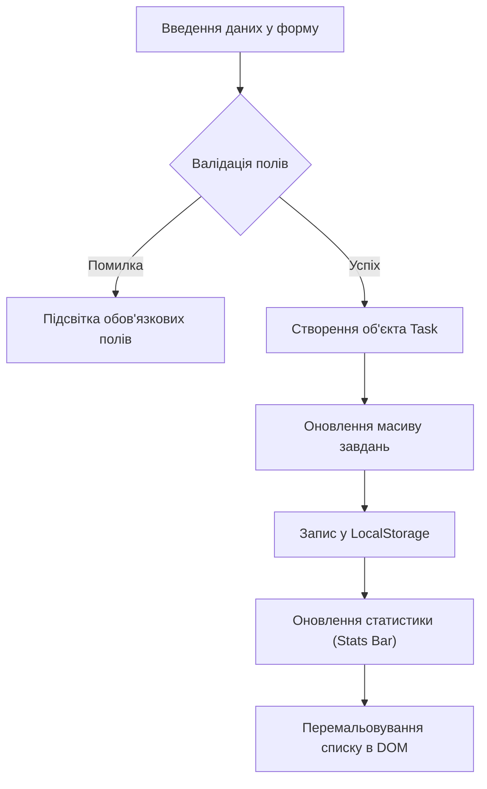

<div align="center">


# TaskPulse · Трекер навчальних проєктів

[](LICENSE)
[]()
[]()
[]()

**Сучасний клієнтський веб-додаток для контролю дедлайнів, планування спринтів та відстеження статусу практичних робіт.**

[Демонстрація](#-використання) • [Встановлення](#-встановлення) • [Архітектура](#-архітектура-роботи-додатка) • [Взаємне оцінювання](#-матеріали-до-практичної-роботи-3)

</div>

---

> **Програмне забезпечення ПК · Розділ ІІ · Практична робота 3**  
> **Тема 2:** Markdown і документація проєкту  
> **Виконала:** Бондарчук Дарина (група КН-25)  
> **Форма контролю:** Усне опитування (УО)

---

## 📖 Опис проєкту

**TaskPulse** — це легкий, модульний веб-інструмент, створений для студентів спеціальності «Комп'ютерні науки». Додаток вирішує проблему хаотичного розкиду завдань між різними навчальними платформами: він агрегує дедлайни, категоризує практичні та лабораторні роботи і автоматично зберігає актуальний прогрес у браузерному сховищі `LocalStorage` без потреби у важких сторонніх серверах.

---

## ⚡ Особливості та функціонал

* 🚀 **Миттєве додавання:** швидке створення задач із категорією та дедлайном.
* 💾 **Повна автономність:** збереження даних на клієнті через Web Storage API.
* 📊 **Жива аналітика:** автоматичний підрахунок кількості активних і виконаних робіт.
* 📱 **Адаптивний дизайн:** сучасний UI на CSS Grid та Flexbox, оптимізований для ПК і смартфонів.

---

## 💻 Встановлення

Для запуску проєкту на локальному комп'ютері потрібен лише встановлений Git та будь-який сучасний веб-браузер (Safari, Google Chrome, Mozilla Firefox).

### 1. Клонування репозиторію
```bash
git clone git@github.com:bondarchukdvkn25-maker/practical-work-3.git
```

### 2. Перехід до робочого каталогу
```bash
cd practical-work-3
```

### 3. Локальний запуск
Оскільки додаток реалізовано на нативних веб-технологіях, сторонні пакети `npm` або сервери не потрібні. Досить відкрити файл `index.html`:
```bash
# Для macOS:
open index.html

# Для Linux:
xdg-open index.html

# Для Windows (PowerShell):
Start-Process index.html
```

---

## 🎯 Використання

1. **Додавання завдання:** введіть тему (наприклад, *"Практична робота 4"*), оберіть категорію (*Git & GitHub*) та призначте кінцевий термін.
2. **Зміна статусу:** натисніть на чекбокс біля завдання — лічильник у верхній панелі моментально оновить статистику виконання.
3. **Видалення:** натисніть піктограму кошика 🗑️ для завершеного завдання.

### Приклад коду обробки стану (JavaScript):
```javascript
// Збереження списку завдань у пам'ять браузера
function saveAndRender() {
  localStorage.setItem('taskpulse_tasks', JSON.stringify(tasks));
  render();
}
```

---

## 🛠 Технологічний стек

| Модуль | Технологія | Призначення |
| :--- | :--- | :--- |
| **Розмітка** | `HTML5` | Семантична структура та форми вводу даних |
| **Стилізація** | `CSS3 (Custom Properties)` | Адаптивна тема, сітки Grid, анімації |
| **Логіка** | `Vanilla JavaScript (ES6+)` | Маніпуляції з DOM, обробка подій, валідація |
| **Сховище** | `Web Storage (LocalStorage)` | Персистентне збереження стану користувача |
| **Контроль версій** | `Git / GitHub` | Відстеження історії змін, релізи та документація |

---

## 🔄 Архітектура роботи додатка

Порядок обробки даних користувача та оновлення інтерфейсу проілюстровано на діаграмі:



---

## 📚 Матеріали до Практичної роботи 3

### 1. Відповіді для усного опитування (УО):
* **Чому README є «обличчям» репозиторію?**  
  README — перший файл, який читають розробники, рекрутери та користувачі. Він за 30 секунд повинен пояснити, що робить проєкт, чому він корисний і як його швидко запустити.
* **Які обов'язкові розділи повинен містити професійний README?**  
  1. Назва та опис проєкту (коротке позиціонування).  
  2. Інструкція зі встановлення (конкретні команди терміналу).  
  3. Інструкція з використання (приклади та фрагменти коду).  
  4. Ліцензія (умови використання коду).  
  5. Контакти та відомості про автора.
* **Чим синтаксис GitHub Flavored Markdown (GFM) розширює базовий Markdown?**  
  GFM додає підтримку таблиць (`| col |`), списків завдань (`- [x]`), автопосилань, підсвічування синтаксису в блоках коду та вбудованих діаграм **Mermaid**.

### 2. Взаємне оцінювання (Peer Review):
* Шаблон взаємної оцінки документації одногрупника за критеріями викладача розміщено у файлі **[`PEER_REVIEW.md`](PEER_REVIEW.md)**.

---

## 📄 Ліцензія

Цей проєкт ліцензовано за умовами ліцензії **MIT**. Докладніший текст ліцензії можна знайти у файлі [LICENSE](LICENSE).

---

## 👤 Автори та контакти

* **Автор:** Бондарчук Дарина
* **Академічна група:** КН-25
* **GitHub:** [@bondarchukdvkn25-maker](https://github.com/bondarchukdvkn25-maker)
* **Email:** bondarchuk.d.v_kn25@rcit.ukr.education
